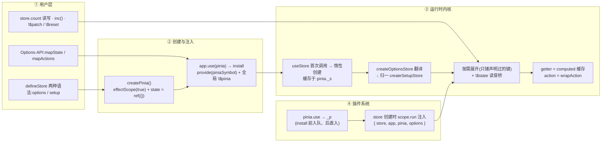

# mini-pinia 文档(总览)

> 为学习 **Pinia 4** 原理而写的中文最小实现:代码与官方 pinia 4.1.0 逐一对应,
> 行为以官方为唯一基准,注释即教材。

## 1. 引言:这是什么

mini-pinia 从零镜像 [Pinia](https://github.com/vuejs/pinia) 4.1.0(Vue 3 + TypeScript),三个关键词:

- **最小**:源码只有 `src/` 下 8 个文件;官方 `dist/pinia.js` 是 `packages/pinia/src/*` 的平铺(1535 行,`//#region` 标记),mini 每块都能在官方找到对应位置(第 3 节表格);
- **行为对拍**:`npm run probe` 用 31 条探测先把官方边界行为钉死;`tests/parity.spec.ts` 让同一批 store 定义分别跑官方与 mini——状态、getter 值、$patch 结果、订阅事件序列、action 调用链**必须一致**;
- **注释即教材**:每个源文件头注释写明「对应官方位置 + 教学点 + 简化点」,没做到的简化诚实记入 docs/06。

> **一句话原理**
>
> store = 一张「只摊开声明过键」的响应式视图 + 一份藏在 `pinia.state` 里的原始数据仓库,
> `$state` 是两者之间的读穿桥;一切操作 API($patch / $subscribe / $onAction / $reset)
> 围绕「同一份数据 + 一个 Set 事件总线」工作。

## 2. 架构图



## 3. 模块职责表(对应官方 dist/pinia.js 行号区间)

| mini 模块 | 职责 | 官方 dist/pinia.js |
| --- | --- | --- |
| createPinia.ts | pinia 实例:根 effectScope(true)、state=ref({})、install/use、disposePinia | 833-881(createPinia.ts) |
| rootStore.ts | 模块级 activePinia、set/getActivePinia、getStores、piniaSymbol | 63-106(rootStore.ts) |
| subscriptions.ts | Set 订阅容器:addSubscription / triggerSubscriptions | 953-968(subscriptions.ts) |
| utils.ts | noop / isPlainObject / isComputed / mergeReactiveObjects | 官方分两处:types 区内(isPlainObject ≈108)、store 区内(mergeReactiveObjects ≈981) |
| store.ts | defineStore、createOptionsStore、createSetupStore、全部 $ 方法、wrapAction、插件执行 | 969-1382(store.ts) |
| storeToRefs.ts | 按 computed/ref/reactive/其他 分类提取可解构 refs | 1510-1534(storeToRefs.ts) |
| mapHelpers.ts | mapState / mapGetters / mapActions / mapWritableState | 1383-1509(mapHelpers.ts) |
| types.ts | 公开类型骨架、MutationType 常量、插件扩展空接口 | 107-137(types.ts) |
| index.ts | 导出面与官方 index.ts 对齐 | 导出语句分布全文件 |

> 官方平铺里 mini 未实现的区域:env.ts(9-11)、diagnostics.ts(12-62)、devtools/*(138-832)、hmr.ts(882-952)、mapStores/setMapStoreSuffix 等 —— 全部记入 docs/06。

## 4. 阅读顺序

| 顺序 | 文档 | 要回答的问题 |
| --- | --- | --- |
| README | 本文 | 全貌:模块地图、架构、怎么自测 |
| 01 | defineStore 语法归一 | 两种语法怎么变成同一条创建管线 |
| 02 | 响应式内核 | store 为什么是响应式的、键从哪来、getter 怎么缓存 |
| 03 | 操作 API | $patch / $subscribe / $onAction / $dispose 的事件语义与时序 |
| 04 | 组件绑定与辅助 | storeToRefs、mapXxx、解构丢响应性的完整答案 |
| 05 | 插件系统 | pinia.use 的注册/执行时机、扩展如何铺到 store |
| 06 | 对照表 | mini↔官方全部简化点、探测结论、类型差异、已知不同 |

## 5. 快速自测

```bash
npm run probe   # 官方 4.1.0 行为探测(31 条,只断言官方;失败 = 官方行为变了)
npm test        # vitest:每模块单元测试 + parity.spec.ts 与官方对拍
npm run dev     # Vite demo(examples/),浏览器里观察全部核心特性
```

两条铁律:先 probe 后实现(行为结论以探测定死,不凭记忆猜);改动后跑 `npm test`(对拍集保住「与官方一致」这个唯一基准)。